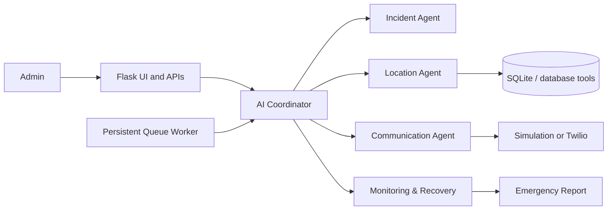

# QuickFire AI

QuickFire AI is a Windows-friendly Flask prototype for autonomous, human-supervised fire emergency coordination. It uses five specialized roles (coordinator plus four execution agents), SQLite persistence, Haversine radius filtering, Leaflet/OpenStreetMap, simulated SMS, optional Twilio real SMS, transparent live-research status, persistent jobs, retries, audit logs and incident reports.

> Prototype notice: QuickFire AI is not a certified emergency-response or life-safety system. It never automatically contacts public emergency services or unregistered phones.

## Architecture



## Agent roles

- **AI Coordinator:** creates the plan, assigns tasks, passes structured outputs and records outcomes.
- **Incident Analysis Agent:** validates coordinates and required data, applies transparent severity rules and flags invalid reports.
- **Location Intelligence Agent:** retrieves consented registered people and applies Haversine radius filtering.
- **Emergency Communication Agent:** generates messages, prevents duplicate notification records and dispatches in simulation or real mode.
- **Monitoring & Recovery Agent:** monitors delivery, retries transient failures, records attempts and generates reports.

## Windows setup

```powershell
cd "c:\Users\ashwa\OneDrive\Desktop\rishnat developer\The-code-squad"
py -3.14 -m venv .venv
.\.venv\Scripts\Activate.ps1
python -m pip install --upgrade pip
pip install -r requirements.txt
Copy-Item .env.example .env
python app.py
```

Open http://127.0.0.1:5000

Demo login:
- Email: `admin@quickfire.local`
- Password: `Admin@123`

## Deploy from GitHub with Render

1. Commit and push this repository to GitHub.
2. In Render, choose **New → Blueprint**, connect the GitHub repository, and deploy its `render.yaml`.
3. After the first deploy, open the service's **Environment** settings to retrieve the generated `ADMIN_PASSWORD`. Sign in with that password and the configured `ADMIN_EMAIL`.

The included free Render service uses temporary storage for SQLite, so database changes can be lost when the service restarts or redeploys. Use a paid Render instance with a persistent disk before relying on saved incidents or recipient data. SMS remains in simulation mode by default.

## Background worker

The application also supports synchronous desktop demonstration execution. To run the persistent SQLite worker separately:

```powershell
python workers/worker.py
```

The web server and worker share `quickfire.db`; jobs and task history persist after restart.

## Demo

1. Sign in.
2. Open **Report Emergency**.
3. Keep the campus coordinates, High severity and 1 km radius.
4. Select **Simulated SMS**.
5. Submit `REPORT FIRE EMERGENCY`.
6. Open **AI Agent Control Center** to inspect tasks, decisions and tool calls.
7. Open **Notifications** for delivery outcomes. Recipient ID 5 produces one predictable transient failure, then the monitor retries it.
8. Open **Final Reports** for generated incident output.

## Integrations

- Leaflet and OpenStreetMap map tiles require network access.
- OpenStreetMap Nominatim geocoding is exposed through `GET /api/geocode?address=...`.
- Search integration is honest/degraded when `SEARCH_API_KEY` or `SEARCH_ENGINE_ID` is absent.
- SMS is simulation by default. Real Twilio credentials require `TWILIO_ACCOUNT_SID`, `TWILIO_AUTH_TOKEN` and `TWILIO_FROM_NUMBER` plus explicit checkbox approval.
- `LLM_API_KEY` reserves actual AI reasoning configuration; without it, transparent deterministic rules are used.

## Tests

```powershell
python -m pip install -r requirements.txt
python -m pytest -q
```

## Database

SQLite is the zero-install fallback. MySQL-compatible schema concepts are represented in `database/schema.sql`, converted to SQLite syntax. Set `DATABASE_URL` to another SQLite file path if required. The application initializes and seeds data automatically.

## Known limitations

- SQLite is the demonstration fallback; no MySQL client is bundled.
- Worker threading is suitable for a laptop demo, not distributed production.
- Live search and geocoding depend on external availability.
- Real SMS is disabled unless credentials and administrator approval are present.

## Real-world Twilio SMS setup

1. Create a Twilio account and obtain a verified sending number.
2. Copy `.env.example` to `.env`.
3. Set `TWILIO_ACCOUNT_SID`, `TWILIO_AUTH_TOKEN`, and `TWILIO_FROM_NUMBER`.
4. Host the Flask app over HTTPS with a public callback URL.
5. Set `TWILIO_STATUS_CALLBACK_URL=https://your-public-domain/api/sms/status`.
6. Register consent and an E.164 phone number for every recipient.
7. Choose **Real SMS gateway** and check the explicit approval box.

The Twilio status callback updates accepted, delivered, failed, or undelivered provider states. Provider acceptance is not a claim of final handset delivery until a callback confirms it. On a localhost laptop, real delivery is possible only with valid credentials and internet access, while public callbacks require HTTPS tunneling or hosting.
